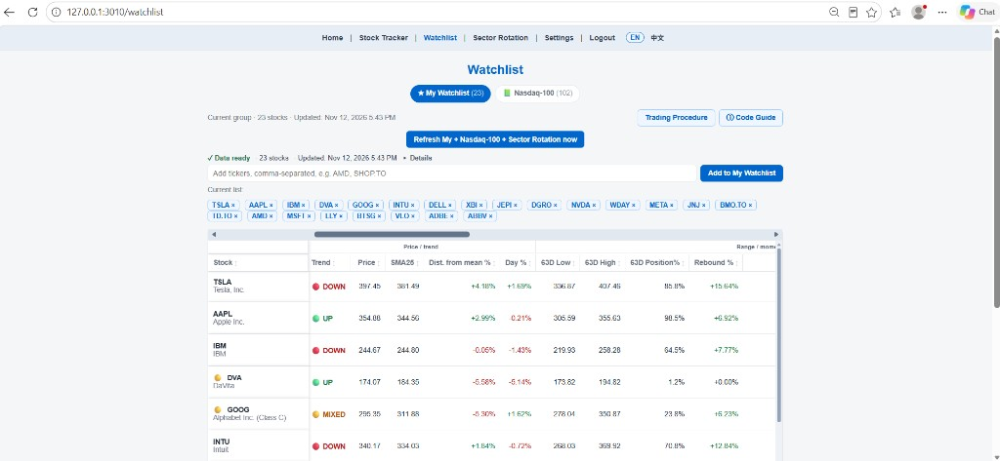
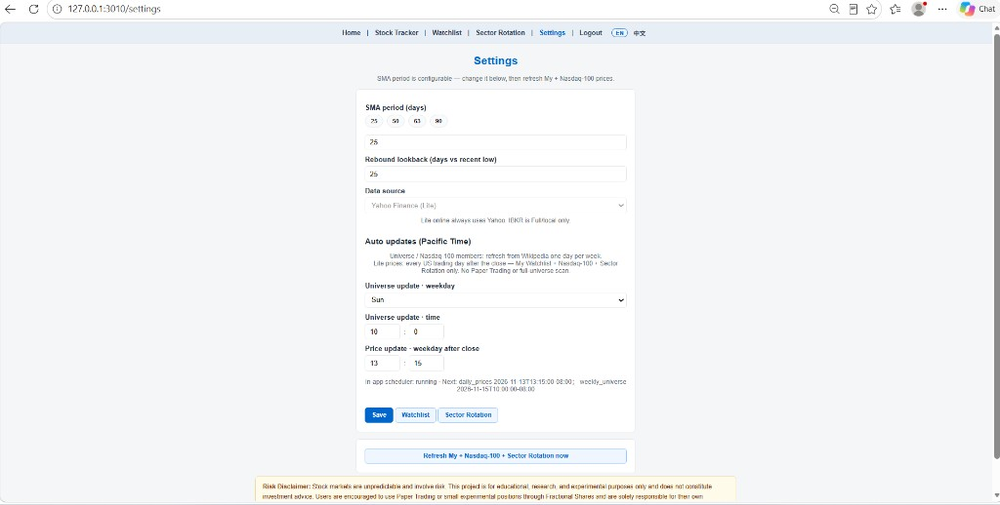
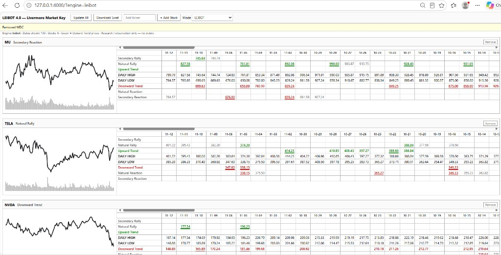
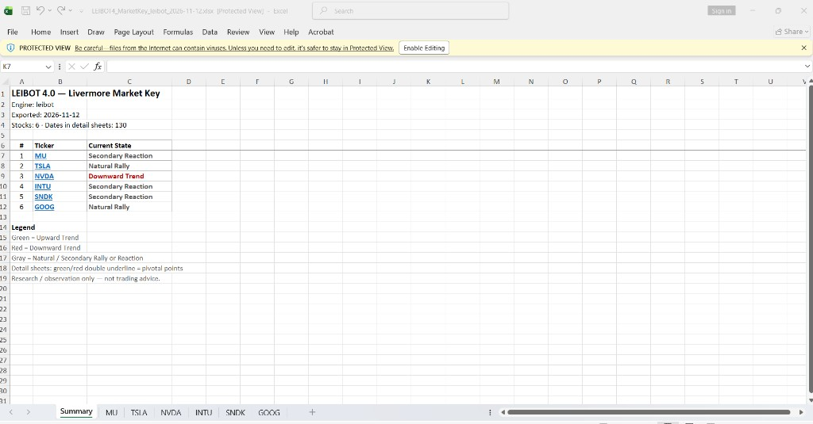
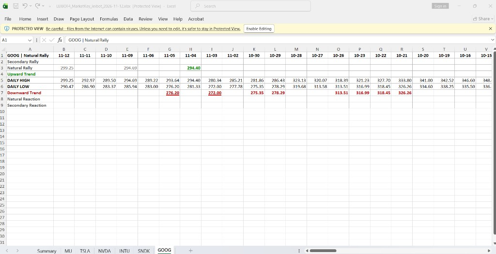

# Stock Tracker Portfolio

Lei Wang

A portfolio showcasing two independently developed Python-based stock research applications: Stock Tracker Lite and LEIBOT 4.0.

The projects demonstrate financial data processing, moving-average analysis, trend classification, interactive dashboards, and Excel reporting using Python, Pandas, Flask, and SQLite.

This repository contains selected screenshots and technical descriptions. The complete application source code and proprietary research rules remain private.

## Stock Tracker Lite

A local watchlist for prices and moving averages.

```python
average = sum(closes[-window:]) / window
distance = (price - average) / average
```

Windows are 25, 63, and 252 trading days. SMA63 against SMA252 sets the trend label.





## LEIBOT 4.0

A local Livermore Market Key sheet. Six states: Upward Trend, Downward Trend, Natural Rally, Natural Reaction, Secondary Rally, Secondary Reaction. The recording rules stay private. Prices and the reading are stored apart, and Excel uses the same date order as the screen.







A missing close is filled only when that price belongs to the same session. The newest date stays on the left.

## Acknowledgments

Reference calculators in the private LEIBOT project, not included here: Dyno Fu, LMK, MIT, Copyright (c) 2016 Dyno Fu.

Studied reference, also not included: quant001, project Jesse-Livermore. No personal name was published with that project.

Libraries, used as installed packages: Python, pandas, NumPy, Flask, yfinance, Matplotlib, openpyxl.

Research only. Not investment advice.
